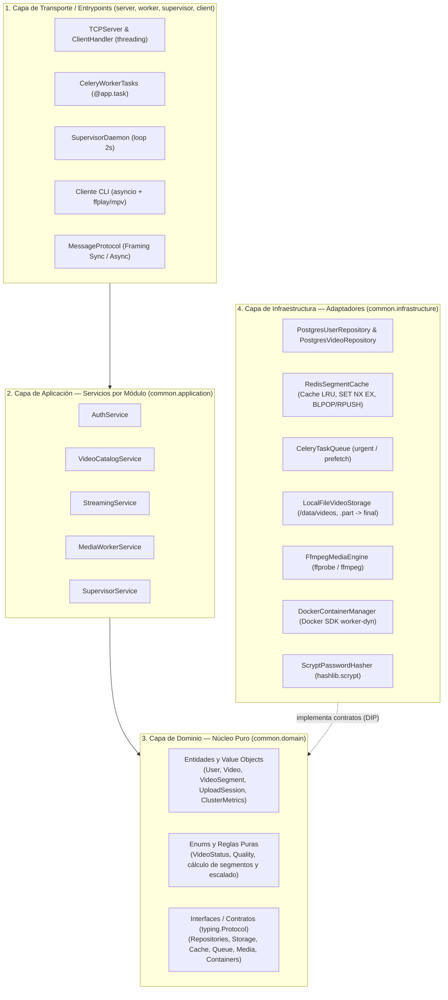

# Arquitectura de Software y Guía de Ingeniería — Reproductor de Video Distribuido

> Documento rector de arquitectura en N capas, principios de diseño y metodología de trabajo del proyecto.
> Última actualización: 2026-10-25.

---

## 1. Metodología y Principios de Ingeniería

Todo el desarrollo del sistema se rige por las siguientes prácticas:

### 1.1. TDD (Test-Driven Development)
Trabajamos bajo el ciclo **Red → Green → Refactor**:
1. **Red:** Escribir primero un test automatizado que falle definiendo el comportamiento esperado a través de la interfaz del módulo.
2. **Green:** Escribir la mínima cantidad de código de producción necesaria para que el test pase.
3. **Refactor:** Limpiar el código eliminando duplicación y mejorando la expresividad manteniendo los tests en verde.

**Estrategia de pruebas por capa:**
- **Dominio y Aplicación (Unitarios rápidos):** Se testean sin levantar Docker, PostgreSQL ni Redis, inyectando implementaciones en memoria (*Fakes* / `fakeredis`). Deben correr en milisegundos.
- **Protocolo y Transporte:** Se testean con `socket.socketpair()` y streams en memoria verificando framing sincrónico y asincrónico.
- **Infraestructura (Integración):** Tests acotados para validar consultas SQL reales, comandos `ffmpeg`/`ffprobe`, sistema de archivos y Docker SDK.

### 1.2. Clean Code
- **Nombres con intención reveladora:** Clases con sustantivos (`VideoCatalogService`, `UploadSession`), métodos con verbos (`begin_upload`, `acquire_segment_lock`).
- **Funciones pequeñas y de única responsabilidad:** Cada función hace una sola cosa y se mantiene en un único nivel de abstracción.
- **Manejo de errores con excepciones:** Se utilizan excepciones de dominio explícitas (`UserAlreadyExistsError`, `InvalidCredentialsError`, `VideoNotReadyError`, `UploadIncompleteError`) en lugar de códigos de retorno ambiguos o `None`.
- **Inyección de dependencias explícita:** Los módulos reciben sus colaboradores por constructor; nunca instancian clientes de base de datos, sockets o subprocesos de forma oculta en su interior.

### 1.3. Principios SOLID, DRY y KISS
- **S — Single Responsibility Principle (SRP):** Ninguna clase acumula responsabilidades de distintas capas (el socket TCP no contiene SQL; el servicio de streaming no construye argumentos de línea de comandos de `ffmpeg`). Se evita explícitamente crear una clase *Orquestador* monolítica (*God Class*).
- **O — Open/Closed Principle (OCP) & L — Liskov Substitution Principle (LSP):** Los servicios de aplicación trabajan contra contratos (`typing.Protocol`), permitiendo sustituir adaptadores reales (Postgres, Redis, Docker) por adaptadores de prueba sin modificar la lógica de negocio.
- **I — Interface Segregation Principle (ISP):** Contratos pequeños y cohesivos separados por rol (`ISegmentCache` separado de `ITaskQueue`, `IUserRepository` separado de `IVideoRepository`).
- **D — Dependency Inversion Principle (DIP):** Las dependencias de código apuntan siempre hacia adentro (hacia el Dominio). La Infraestructura depende del Dominio, nunca al revés.
- **DRY (Don't Repeat Yourself):** El framing del protocolo TCP, las constantes, la configuración y el núcleo de negocio viven en un paquete compartido (`common/`) reutilizado por `server`, `worker`, `supervisor` y `client`.
- **KISS (Keep It Simple, Stupid):** Sin sobreingeniería ni capas pasamanos. Se usan `dataclass` del dominio directamente entre capas internas y una mini-estructura liviana para el cliente CLI.

---

## 2. Arquitectura en N Capas (4 Capas con Inversión de Dependencias)

El sistema se organiza en **4 capas concéntricas** donde la dirección de dependencia fluye hacia el **Dominio**:



---

## 3. Responsabilidades y Clases por Capa

### 3.1. Capa de Dominio (`common/domain/`)
No tiene dependencias de librerías externas (solo librería estándar de Python).

- **Entidades y Value Objects:**
  - `User`: `id`, `username`, `password_hash`, `created_at`. Reglas de validación de formato de `username` (3–32 caracteres alfanuméricos/`_`) y longitud mínima de password.
  - `Video`: `id (UUID)`, `owner_id`, `title`, `original_filename`, `path`, `size_bytes`, `duration_s`, `width`, `height`, `status (VideoStatus)`, `created_at`.
  - `VideoSegment`: Identificador y metadatos de un fragmento `(video_id, quality, index, duration_s=4)`.
  - `UploadSession`: Estado de una subida por chunks en curso (`video_id`, `owner_id`, `expected_bytes`, `received_bytes`, `temp_path`, `final_path`).
  - `ClusterMetrics`: Fotografía de carga del cluster (`pending_urgent`, `pending_prefetch`, `active_workers`, `desired_workers`, `last_scale_up_at`).
- **Enumeraciones:**
  - `VideoStatus`: `UPLOADING`, `PROCESSING`, `READY`, `ERROR`.
  - `Quality`: `Q480 = 480`, `Q720 = 720`.
- **Reglas de Negocio Puras:**
  - Validación de extensiones de archivo permitidas: `mp4`, `mkv`, `webm`, `mov`, `avi`.
  - Determinación de calidades disponibles según la altura original (`480p` siempre; `720p` solo si `height >= 720`).
  - Cálculo del número total de segmentos de 4 segundos a partir de `duration_s`.
  - Fórmula de autoescalado: `desired = clamp(ceil(pending / TASKS_PER_WORKER), MIN_WORKERS, MAX_WORKERS)` con histéresis (subida rápida, bajada de a 1 worker) y ventana de cooldown.
- **Interfaces / Puertos (`typing.Protocol`):**
  - `IUserRepository`: `create()`, `get_by_username()`, `get_by_id()`.
  - `IVideoRepository`: `create()`, `get_by_id()`, `update_status_and_metadata()`, `list_ready()`, `list_by_owner()`, `delete()`.
  - `IPasswordHasher`: `hash_password()`, `verify_password()`.
  - `IVideoStorage`: `create_temp_file()`, `append_chunk()`, `finalize_upload()`, `remove_files()`.
  - `ISegmentCache`: `get_segment()`, `put_segment()`, `try_lock_segment()`, `release_lock()`, `notify_segment_ready()`, `notify_segment_error()`, `wait_for_segment()`.
  - `ITaskQueue`: `enqueue_probe()`, `enqueue_transcode(segment, priority_queue)`.
  - `IMediaEngine`: `probe(path)`, `transcode_segment(path, segment)`.
  - `IContainerManager`: `get_queue_and_worker_metrics()`, `list_dynamic_workers()`, `spawn_worker()`, `shutdown_and_remove_worker()`, `publish_supervisor_metrics()`, `get_supervisor_metrics()`.

---

### 3.2. Capa de Aplicación (`common/application/`)
Contiene los **Servicios de Aplicación divididos por módulo**, evitando concentrar todo en una única clase orquestadora:

1. **`AuthService`**
   - Depende de: `IUserRepository`, `IPasswordHasher`.
   - Operaciones: `register(username, password)`, `authenticate(username, password)`.
2. **`VideoCatalogService`**
   - Depende de: `IVideoRepository`, `IVideoStorage`, `ITaskQueue`.
   - Operaciones:
     - Ciclo de subida: `begin_upload()`, `upload_chunk()`, `finish_upload()` (verifica tamaño, renombra `.part`, pasa a `processing` y encola `probe_video`), `abort_upload()` (limpia `.part` y registro en BD).
     - Consultas: `list_public_catalog()`, `list_user_videos(user_id)`, `get_video_details(video_id)`.
3. **`StreamingService`**
   - Depende de: `IVideoRepository`, `ISegmentCache`, `ITaskQueue`.
   - Operaciones: `prepare_playback(video_id, quality, start_segment)` y `fetch_segment(video_id, quality, index)` (encola `index` en `urgent` con deduplicación `SET NX`, encola `index+1 .. index+PREFETCH` en `prefetch` y espera en `BLPOP` hasta retornar los bytes del segmento).
4. **`MediaWorkerService`**
   - Depende de: `IVideoRepository`, `ISegmentCache`, `IMediaEngine`.
   - Operaciones:
     - `analyze_uploaded_video(video_id)`: ejecuta `ffprobe`, valida stream de video y actualiza a `ready` o `error`.
     - `transcode_video_segment(video_id, quality, index)`: ejecuta `ffmpeg`, guarda en caché con TTL y despierta a los hilos en espera con `RPUSH` (o publica marcador de error si falla).
5. **`SupervisorService`**
   - Depende de: `IContainerManager`.
   - Operaciones: `evaluate_and_scale()`: mide carga, aplica la regla de dominio de escalado con cooldown/histéresis, crea o detiene contenedores `worker-dyn` de forma segura y publica las métricas para el comando `STATUS`.

---

### 3.3. Capa de Infraestructura (`common/infrastructure/`)
Implementaciones concretas de los contratos del Dominio:

- `PostgresUserRepository` y `PostgresVideoRepository` sobre un `DatabasePool` (`psycopg_pool`).
- `ScryptPasswordHasher` (`hashlib.scrypt` con salt aleatorio + `hmac.compare_digest`).
- `LocalFileVideoStorage` (resolución segura de rutas `/data/videos/<uuid>.<ext>` previniendo *path traversal*).
- `RedisSegmentCache` (operaciones atómicas sobre Redis para caché LRU, locks `SET NX EX`, listas `ready:{vid}:{q}:{i}` y heartbeats).
- `CeleryTaskQueue` (productor de tareas hacia las colas `default`, `urgent` y `prefetch`).
- `FfmpegMediaEngine` (invocación de `ffprobe` y `ffmpeg` con `subprocess`, generando MPEG-TS con `-output_ts_offset`).
- `DockerContainerManager` (uso del Docker SDK sobre `/var/run/docker.sock`, autodescubrimiento de red/volumen y apagado ordenado de Celery antes de remover el contenedor).

---

### 3.4. Capa de Transporte / Entrypoints (`server/`, `worker/`, `supervisor/`, `client/`)

- **`common/protocol.py` (`MessageProtocol`):**
  - Empaquetado y desempaquetado del protocolo binario/JSON `[4 bytes length][JSON header][binary payload]` tanto en versión sincrónica (`send_msg`, `recv_msg`) como asincrónica (`async_send_msg`, `async_recv_msg`).
- **`server/`:**
  - `TCPServer`: Socket con `SO_REUSEADDR`, control de concurrencia máxima con `threading.Semaphore(MAX_CLIENTS)`, 1 hilo por cliente y apagado ordenado (`SIGTERM`/`SIGINT`).
  - `ClientHandler`: Mantiene el estado de la sesión del socket (usuario autenticado, `UploadSession` activa), aplica `@requires_auth` y despacha los comandos (`REGISTER`, `LOGIN`, `LOGOUT`, `LIST`, `MY_VIDEOS`, `VIDEO_INFO`, `UPLOAD_BEGIN`, `UPLOAD_CHUNK`, `UPLOAD_END`, `PLAY`, `STATUS`, `BYE`) hacia los servicios de aplicación.
- **`worker/`:**
  - Configuración de `celery_app` (`prefetch_multiplier=1`, `acks_late=True`, `reject_on_worker_lost=True`) y definición de tareas `@app.task` delgadas que delegan en `MediaWorkerService`.
- **`supervisor/`:**
  - Loop sincrónico cada 2 segundos que invoca a `SupervisorService.evaluate_and_scale()`.
- **`client/` (Mini-estructura interna para CLI + `asyncio`):**
  - `AsyncServerClient`: Gestiona la conexión TCP asincrónica con el servidor usando `common/protocol.py` y traduce errores del protocolo en excepciones claras.
  - `StreamBufferPlayer`: Coordina dos corrutinas concurrentes: una receptora que alimenta una `asyncio.Queue` acotada (backpressure) y una reproductora que espera el buffer inicial de 2 segmentos y escribe en el `stdin` de `ffplay` o `mpv`.
  - `ClientCLI`: Interfaz de línea de comandos (`argparse`), lectura de archivos por chunks con `asyncio.to_thread`, barra de progreso y selección interactiva (`browse`).

---

## 4. Estructura de Paquetes del Repositorio

Alineada con la **Issue #1** y la **Opción A1** (capas del núcleo en `common/` y puntos de entrada por proceso):

```text
.
├── common/
│   ├── __init__.py
│   ├── config.py                # Variables de entorno y valores por defecto
│   ├── protocol.py              # Framing [4B][JSON][payload] sync y async
│   ├── domain/                  # Capa 3: Entidades, Enums, Reglas puras e Interfaces (Protocol)
│   ├── application/             # Capa 2: AuthService, VideoCatalogService, StreamingService, etc.
│   └── infrastructure/          # Capa 4: Adaptadores Postgres, Redis, Celery, FFmpeg, Filesystem, Docker
├── server/                      # Capa 1 (Entrypoint Server TCP + ClientHandler)
├── worker/                      # Capa 1 (Entrypoint Celery app + definición de tasks + heartbeat)
├── supervisor/                  # Capa 1 (Entrypoint loop de monitoreo y autoescalado)
├── client/                      # Capa 1 (Mini-estructura: CLI + AsyncServerClient + StreamBufferPlayer)
├── db/
│   └── init.sql                 # Esquema PostgreSQL (tablas users y videos)
├── docs/
│   ├── CONTEXTO.md
│   ├── ARQUITECTURA.md          # Este documento
│   └── ISSUES.md
└── tests/                       # Suite de tests (unitarios por capa e integración)
```
