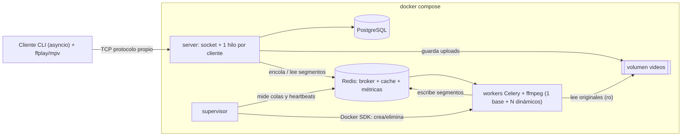

# Contexto del proyecto — Reproductor de video distribuido

> Documento para retomar el proyecto (personas o agentes de IA) sin tener que reconstruir las conversaciones previas.
> Última actualización: 2026-10-25.

## 1. Qué es el proyecto

Proyecto de la materia (UM, 3er año). Es un **reproductor de video multiusuario y distribuido**, del estilo de YouTube pero con cliente por terminal:

1. El usuario se **registra** e inicia **sesión**.
2. **Sube un video propio** desde su máquina. El servidor lo guarda como archivo en un volumen Docker y lo registra en la BD.
3. En segundo plano se **analiza** con `ffprobe` (duración, resolución). Cuando termina, el video queda en estado `ready`.
4. El video aparece en el **catálogo**, y cualquier usuario lo **elige** y lo **reproduce**.
5. La reproducción se divide en **segmentos**, y **workers distintos** transcodifican segmentos distintos, así ninguno se satura.
6. Un **supervisor** mide la carga y **crea o elimina contenedores worker** según la necesidad.

> [!IMPORTANT]
> Los videos **no se generan**: siempre los sube el usuario. No usar videos sintéticos (`ffmpeg testsrc`) como parte del flujo ni de las pruebas principales.

---

## 2. Decisiones tomadas (confirmadas por el equipo)

| Tema | Decisión |
|---|---|
| Lenguaje | Python 3.12, implementado "a mano" |
| Framework web | **No** se usa |
| Comunicación cliente-servidor | Sockets TCP con un protocolo propio |
| Concurrencia en el servidor | `threading`: **un hilo por cliente** |
| `asyncio` | **Sí**, en el **cliente** (conexión, upload, reproducción, prueba de carga) |
| `multiprocessing` | **No** por ahora |
| Cola de tareas | Celery con **Redis** como broker |
| Cache de segmentos | Redis (TTL, política `allkeys-lru`) |
| Base de datos | **PostgreSQL**, para usuarios y metadata de videos |
| Almacenamiento de videos | Archivos en un volumen Docker (`/data/videos/<uuid>.<ext>`). En la BD se guardan el id (UUID) y el path |
| Calidades | **480p y 720p** (720 solo si el original mide al menos 720px) |
| Segmentos | **4 segundos**, en formato MPEG-TS |
| Procesamiento | Transcodificación **on-demand** por segmento, con **prefetch** de los siguientes |
| Escalado | El supervisor **crea y elimina contenedores worker** con el Docker SDK (monta `/var/run/docker.sock`) |
| Cliente | CLI en Python que reproduce con `ffplay` o `mpv` (los segmentos se escriben en el stdin del reproductor) |
| Usuarios | Registro y login con password hasheada (`hashlib.scrypt`). El catálogo es público; incluye `LOGOUT` y `MY_VIDEOS` |
| Formatos de upload | Extensiones permitidas validadas en dominio: `mp4`, `mkv`, `webm`, `mov` y `avi` |
| Arquitectura de software | **4 Capas con Inversión de Dependencias (DIP)** en `common/` + entrypoints por proceso (`server`, `worker`, `supervisor`, `client`), bajo **TDD, Clean Code, SOLID, DRY y KISS** (ver [`ARQUITECTURA.md`](ARQUITECTURA.md)) |
| Despliegue | `docker compose` |

---

## 3. Arquitectura



**Servicios de compose:** `postgres`, `redis`, `server` (puerto 9000), `worker` (base, 1 réplica) y `supervisor`. Todos usan **una misma imagen** (`videoapp:latest`, Python + ffmpeg) y cada uno cambia solo el `command`.

### Claves del diseño
- **Protocolo:** cada mensaje es `[4 bytes con el largo del header][header JSON][payload binario de header["size"] bytes]`. Hay una versión sync (servidor) y una async (cliente) con el mismo formato.
- **Comandos:** `REGISTER`, `LOGIN`, `LOGOUT`, `LIST`, `MY_VIDEOS`, `VIDEO_INFO`, `UPLOAD_BEGIN/CHUNK/END`, `PLAY`, `SEGMENT`, `END`, `STATUS`, `BYE` y `ERROR`.
- **Upload por chunks** de 1 MiB: el archivo se escribe en `.part` y se renombra al terminar. Si la subida queda incompleta, se borran el archivo y el registro. Después se encola `probe_video`.
- **Reproducción (`PLAY`):** por cada segmento `i`, se encola `i` en la cola `urgent` y de `i+1` a `i+PREFETCH` en la cola `prefetch`. El hilo espera con `BLPOP ready:{vid}:{q}:{i}`, lee `seg:{vid}:{q}:{i}` de Redis y lo envía.
- **Deduplicación:** un lock `SET NX EX` por segmento. Si N usuarios miran lo mismo, cada segmento se transcodifica una sola vez.
- **Reparto entre workers:** Celery con `prefetch_multiplier=1`, `acks_late` y `reject_on_worker_lost`. Cada worker toma de a una tarea, así que segmentos consecutivos caen en workers distintos. Si un worker muere, su tarea se reencola.
- **Comando ffmpeg por segmento:** `-ss {i*4} -t 4 -i path -vf scale=-2:{q} -c:v libx264 -preset veryfast -c:a aac -output_ts_offset {i*4} -f mpegts pipe:1`.
- **Supervisor:** cada 2 s lee el largo de las colas y los heartbeats y calcula `desired = clamp(ceil(pending / TASKS_PER_WORKER), MIN, MAX)`. Sube rápido y baja de a uno, con un cooldown después de cada subida. Los workers dinámicos llevan la label `videoapp.role=worker-dyn`. Para bajarlos les manda un `shutdown` ordenado y después borra el contenedor. El worker base nunca se elimina.
- **Cliente asyncio:** una tarea receptora llena una `asyncio.Queue` acotada (backpressure) y una tarea reproductora escribe en el stdin de `ffplay -i pipe:0` (o `mpv -`), empezando después de un buffer de 2 segmentos.

---

## 4. Artefactos del repositorio

| Archivo | Contenido |
|---|---|
| [`ISSUES.md`](ISSUES.md) | Backlog completo: **95 issues atómicas** agrupadas en 12 secciones, cada una con descripción y criterios de aceptación |
| [`ARQUITECTURA.md`](ARQUITECTURA.md) | Definición de la arquitectura en N capas (4 capas con DIP), servicios por módulo, contratos `Protocol`, estructura de paquetes y lineamientos TDD / Clean Code / SOLID / DRY / KISS |
| `docs/CONTEXTO.md` | Este documento |

Todavía no hay código: el repo solo tiene README, LICENSE, `.gitignore`, `ISSUES.md` y `docs/`.

### Secciones de `ISSUES.md`
1. Infraestructura (#1–#12)
2. Protocolo (#13–#18)
3. Servidor — núcleo (#19–#26)
4. Usuarios (#27–#33)
5. Subida de videos (#34–#40)
6. Catálogo (#41–#44)
7. Workers — análisis (#45–#48)
8. Workers — transcodificación (#49–#54)
9. Servidor — reproducción (#55–#62)
10. Supervisor (#63–#72)
11. Cliente asyncio (#73–#87)
12. Pruebas y documentación (#88–#95)

---

## 5. Issues creadas en GitHub

Repositorio: `Franco-Gentile/Proyecto-Computaci-n----`. Se crearon **18 issues** (primer lote: arquitectura base y algo que ya se pueda probar), sin labels ni milestones.

> [!WARNING]
> La numeración de GitHub **no coincide** con la de `ISSUES.md` a partir de la 11. Cada issue de GitHub termina con `Ref: ISSUES.md #N` para poder relacionarlas.

| GitHub | ISSUES.md | Título |
|---|---|---|
| 1 | #1 | Estructura de carpetas del repositorio |
| 2 | #2 | Dependencias del proyecto |
| 3 | #3 | .gitignore para Python y datos locales |
| 4 | #4 | Dockerfile de la aplicación |
| 5 | #5 | Módulo de configuración |
| 6 | #6 | Archivo .env.example |
| 7 | #7 | Tabla `users` |
| 8 | #8 | Tabla `videos` |
| 9 | #9 | Servicios postgres y redis en compose |
| 10 | #10 | Servicio server en compose |
| 11 | #13 | Envío de mensajes (sync) |
| 12 | #14 | Recepción exacta de bytes (sync) |
| 13 | #15 | Recepción de mensajes (sync) |
| 14 | #16 | Envío y recepción async |
| 15 | #17 | Tests del protocolo |
| 16 | #19 | Socket de escucha |
| 17 | #20 | Un hilo por cliente |
| 18 | #23 | ClientHandler y despacho de comandos |

**Por qué se dejaron afuera algunas del rango inicial:**
- **#11 (worker base en compose):** necesita la configuración de Celery (#45). Sin eso el contenedor no arranca.
- **#12 (supervisor en compose):** necesita el código del supervisor.
- **#18 (documento del protocolo):** conviene escribirlo cuando los comandos estén estables.

**Resultado esperado al cerrar este lote:** `docker compose up` levanta postgres, redis y server. Varios clientes se conectan a la vez (un hilo cada uno), intercambian mensajes con el protocolo propio y reciben respuesta (por ejemplo, `ERROR` ante un comando desconocido). Además, `pytest tests/test_protocol.py` pasa.

---

## 6. Próximos pasos sugeridos

1. Implementar las 18 issues creadas (no se escribió código todavía; el equipo indicó **no empezar** hasta que se pida).
2. Siguiente lote recomendado para GitHub:
   - **Usuarios:** #26–#32 (pool de BD, hash de passwords, `REGISTER`, `LOGIN`, `@requires_auth`).
   - **Subida:** #34–#40.
   - **Catálogo:** #41, #42 y #44.
   - **Celery y análisis:** #45–#48 y #11 (worker base en compose).
   - **Cliente básico:** #73–#76 y #80.

   Con eso se puede probar el flujo "registrarse → subir un video → verlo en el catálogo".
3. Después: transcodificación y reproducción (#49–#62, #83–#87), luego supervisor (#63–#72, #12), y por último pruebas y README (#88–#95).

## 7. Cómo crear más issues en GitHub

Se usó `gh` (autenticado como `FranRodeles`) con un script que lee `ISSUES.md`, toma las secciones `### #N Título`, convierte los criterios en checkboxes y agrega `Ref: ISSUES.md #N`. Para un caso puntual alcanza con:

```bash
gh issue create --title "<Título>" --body "<Descripción + criterios>\n\n---\nRef: ISSUES.md #N"
```
